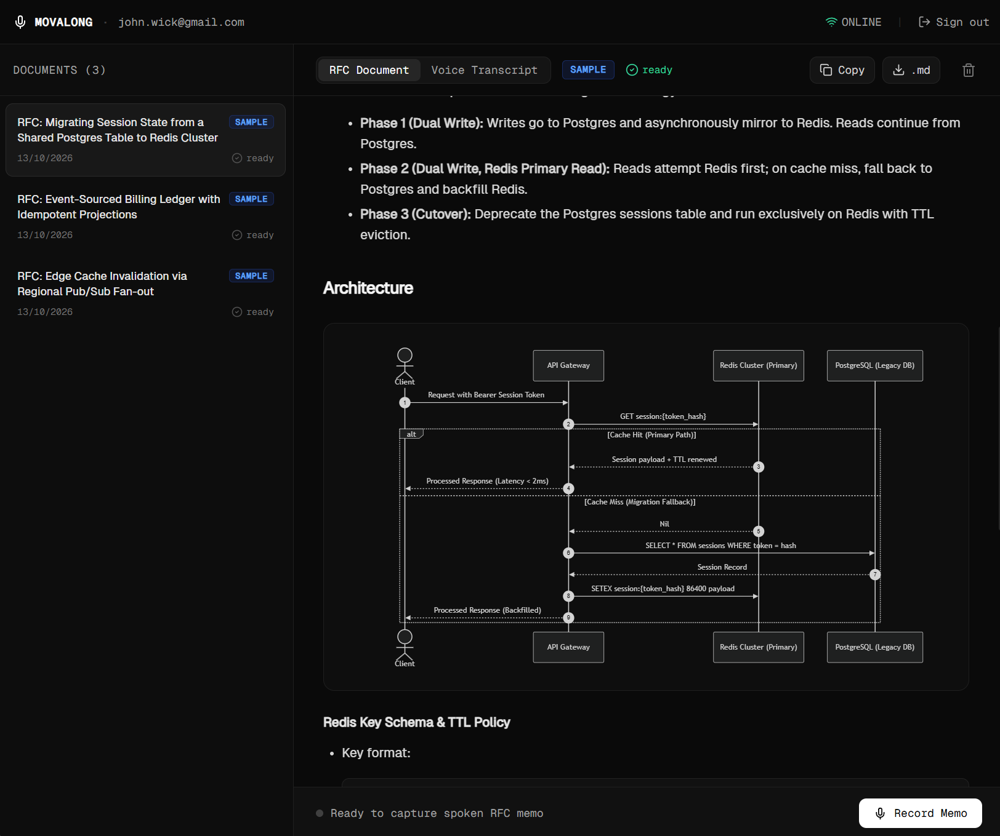
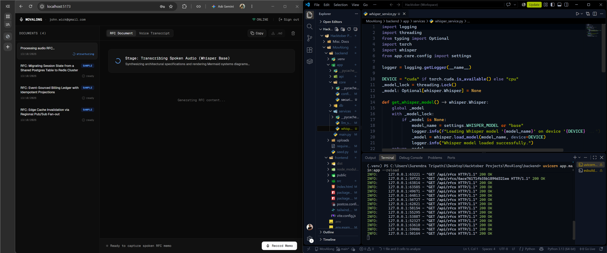
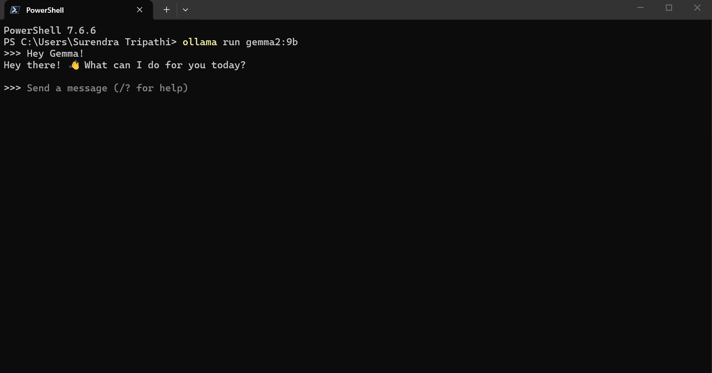

# MovAlong

> An offline-first developer tool that translates unstructured voice notes into formatted Request for Comments (RFCs) and live system architecture diagrams. Built entirely on local inference.

[](https://react.dev)
[](https://fastapi.tiangolo.com)
[](https://ollama.com)
[](https://github.com/openai/whisper)
[](https://opensource.org/licenses/MIT)


*Above: MovAlong's brutalist workspace rendering a live Mermaid.js topology from a transcribed audio rant.*

**MovAlong** was built to solve a specific engineering problem: the best system design happens when you step away from the keyboard and pace the room, but capturing those chaotic architectural thoughts is tedious. 

Built during my continuing strides in open-source development, this tool operates as an asynchronous "rubber duck." By leveraging **PyTorch-accelerated Whisper** and **Gemma 2 9B locally via Ollama**, it untangles unstructured voice recordings into pristine Markdown documentation with absolute data sovereignty and zero runtime API costs.

---

## System Architecture

The flowchart below details the offline-capable asynchronous queue and the local multimodal processing pipeline.

```mermaid
graph TD
    subgraph Client [Browser / Frontend]
        UI[React / Vite UI]
        Recorder[HTML5 MediaRecorder]
        IDB[(IndexedDB Audio Queue)]
        Mermaid[Mermaid.js SVG Renderer]
    end

    subgraph Backend [FastAPI / Python 3.12]
        Auth[JWT Authentication]
        Upload[/api/rfcs/upload-audio]
        Whisper[Whisper STT - CUDA]
    end

    subgraph Local Inference [Local Hardware]
        Ollama[Ollama API :11434]
        Gemma[Gemma 2 9B]
    end

    subgraph Cloud
        MongoDB[(MongoDB Atlas)]
    end

    UI -->|Record Offline| Recorder
    Recorder -->|Store Blob| IDB
    IDB -->|Network Restored| Upload
    
    Upload -->|Authenticate| Auth
    Upload -->|Raw Audio| Whisper
    Whisper -->|Raw Transcript| Ollama
    Ollama <--> Gemma
    
    Ollama -->|Structured Markdown| Upload
    Upload -->|Save RFC| MongoDB
    
    UI <-->|Fetch RFCs| MongoDB
    UI -->|Intercept mermaid blocks| Mermaid
```

---

## Core Engineering Pillars

### I. Decentralized Audio Queue (Offline-First)
Rethinking the standard dependency on continuous Wi-Fi.
* Audio blobs are captured via the `MediaRecorder` API and immediately written to browser storage using `idb-keyval`.
* If the developer is away from their desk with zero signal, thoughts are safely queued.
* A network listener automatically flushes the queue to the FastAPI backend the moment connectivity is restored.

### II. Local Multimodal Pipeline
Zero reliance on proprietary cloud LLMs for proprietary system design.
* **Transcription:** Utilizes `openai-whisper` locked to the `base` model on local CUDA cores (`fp16` enabled) for rapid, thread-safe speech-to-text.
* **Structuring:** Passes the transcript to `gemma2:9b` with a strict Staff Engineer system prompt, enforcing standard RFC formats (Context, Proposal, Drawbacks) and requiring Mermaid.js visual syntax.


*Above: The offline recording interface capturing architectural voice notes.*

### III. Dynamic Diagram Interception
* The frontend utilizes `react-markdown` coupled with a custom code-block interceptor.
* When the local LLM generates a `mermaid` code block, the UI dynamically bypasses standard text rendering and pipes the syntax into the Mermaid.js engine, outputting reactive, dark-themed SVG architecture diagrams in real-time.

### IV. Brutalist Workspace Isolation
* **Design System:** Stripped of all fluff. High-contrast monochromatic UI utilizing `@fontsource/geist-sans` and `@fontsource/geist-mono` for maximum readability.
* **Data Isolation:** Secured via custom PyJWT authentication. Real voice memos and architectural templates remain strictly owner-scoped within MongoDB Atlas, ensuring separate developers maintain isolated workspaces.


*Above: The locally run gemma2:9b on terminal.*

---

## Tech Stack

* **Frontend:** React 18, Vite, Tailwind CSS, React-Markdown, Mermaid, IDB-Keyval.
* **Backend:** Python 3.12, FastAPI, Motor (Async MongoDB), PyJWT, Uvicorn.
* **AI / Inference:** Ollama (Gemma 2 9B), OpenAI Whisper, PyTorch (CUDA 12.4).
* **Database:** MongoDB Atlas (Time-Series & Document Storage).

---

## Quick Start (Run Locally)

### 1. Prerequisites
* Python 3.12+ (via `uv`)
* Node.js 22+
* `ffmpeg` installed in system PATH
* Ollama running `gemma2:9b` locally (`ollama run gemma2:9b`)

### 2. Environment Configuration
Create a `.env` file in the root directory:

```env
MONGODB_URI=mongodb+srv://<your_username>:<your_password>@cluster0...
MONGODB_DB=movalong
JWT_SECRET=<generate_a_random_64_char_string>
```

### 3. Backend & GPU Initialization
Install the CUDA-optimized PyTorch build before installing standard requirements to ensure GPU acceleration for Whisper:

```bash
cd backend
uv venv --python 3.12 .venv
.venv\Scripts\activate
uv pip install torch==2.5.1 --index-url [https://download.pytorch.org/whl/cu124](https://download.pytorch.org/whl/cu124)
uv pip install -r requirements.txt
```

Seed the database with sample architectural RFCs and launch the API:

```bash
python seed.py
uvicorn app.main:app --reload --port 8000
```

### 4. Frontend Initialization

```bash
cd frontend
npm install
npm run dev
```

Navigate to `http://localhost:5173`.